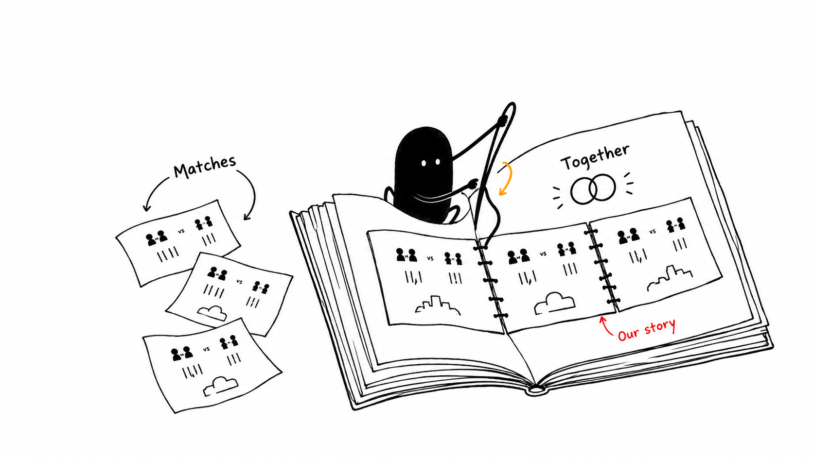
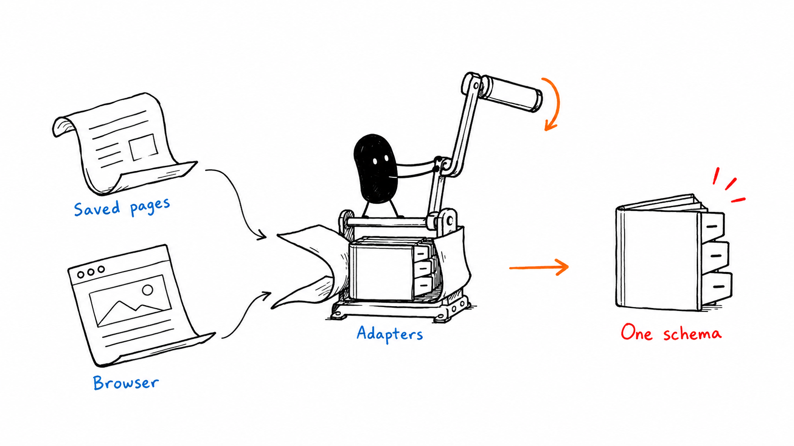
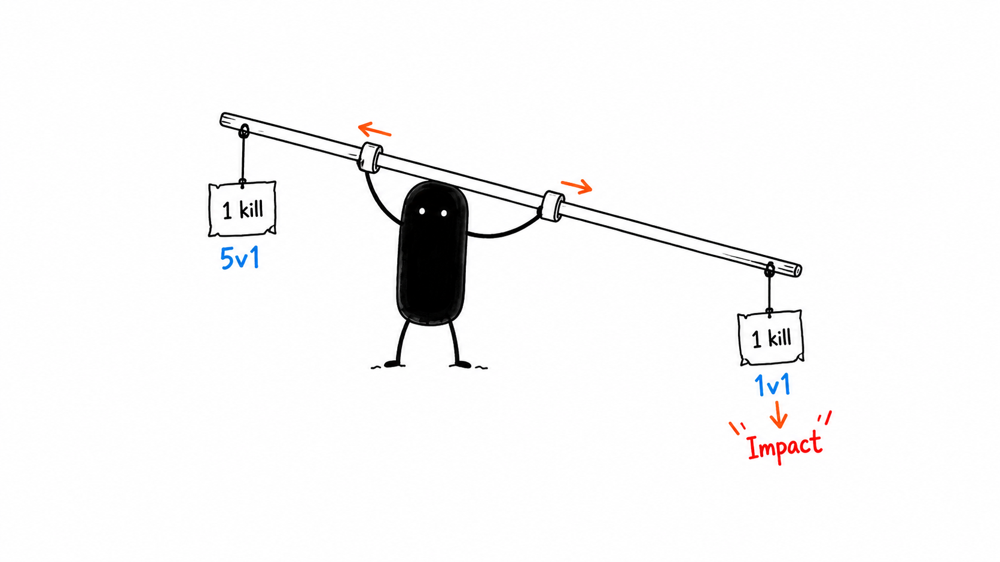
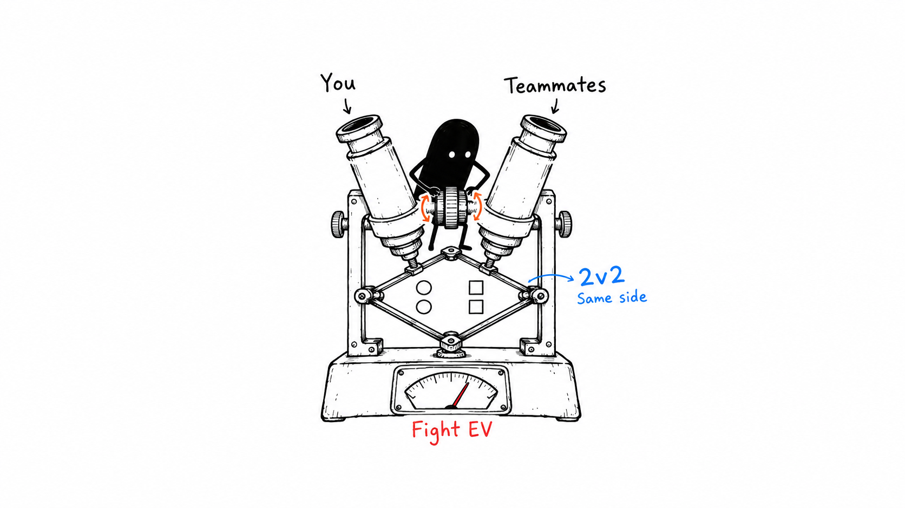
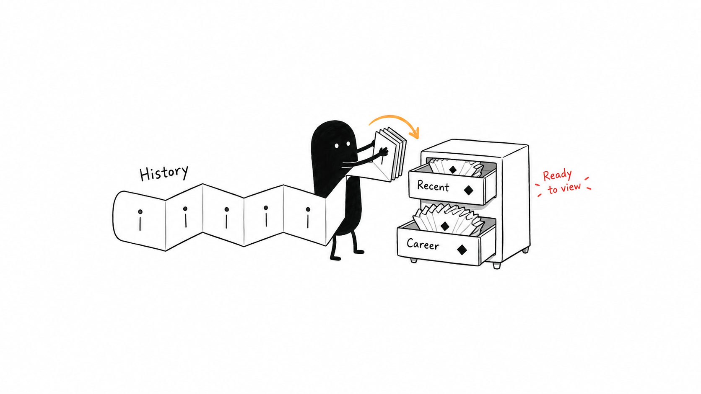
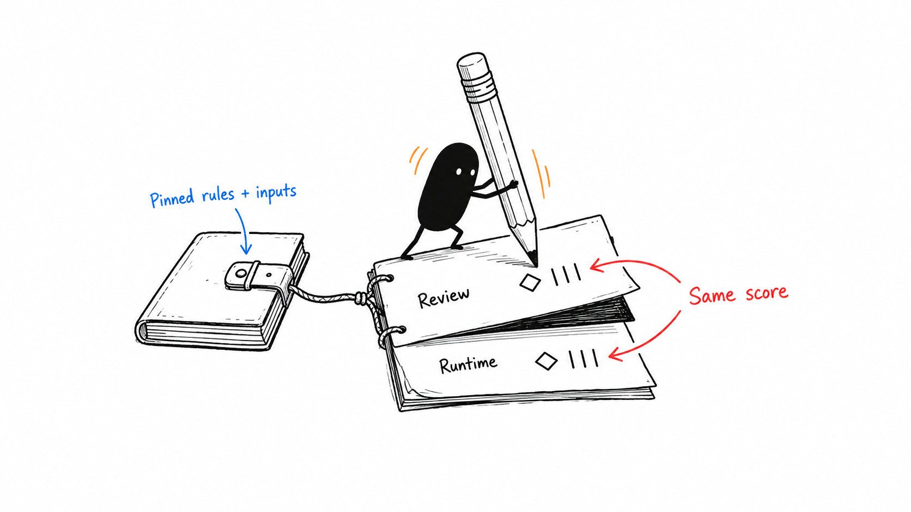

# Valo With Friends — Xiaohei illustrations

Six English-label editorial illustrations generated with the built-in image_gen tool using the ian-xiaohei-illustrations skill. Seven images were generated; the first cache composition was rejected and replaced. Original generations remain in the generator's output directory; exact prompts and original paths are in [prompts.json](prompts.json).

## What the repository is

A Valorant match-analysis application built around players and their friends: match and round detail, squad relationships, shared sessions, custom contextual Impact scores, and state-conditioned fight comparisons. The FastAPI/SQLAlchemy application is the current product. The root GUI/HTML import script is its earlier local data pipeline.

Two existing adapters bring saved-page data and browser-observed tracker.gg match data into the same model. The Riot source enum anticipates another source; it is not evidence of a working live Riot integration. Player views share replay work and use a validated, invalidated cache. The scoring system has substantial candidate evaluation, frozen manifests, review, and release controls.

The checkout's runtime points to the rc3 manifest. The v4 files contain candidate implementation and release-review work. These illustrations describe stable concepts rather than claiming a candidate is active.

## Shot list and placement

| File | Place after the paragraph about | Core idea / structure | Xiaohei's action and main objects | Exact English labels | Priority |
|---|---|---|---|---|---|
| [01-shared-history.png](01-shared-history.png) | Why track matches with friends; squad and session overview | Separate games become shared history; conceptual metaphor | Sews match slips into an open scrapbook with an oversized needle | Matches; Together; Our story | Core; strongest opening |
| [02-one-data-language.png](02-one-data-language.png) | Existing imports and the source-agnostic model | Different inputs, common records; small workflow scene | Operates a wonky binding press; saved pages and browser sheets become one tabbed ledger | Saved pages; Browser; Adapters; One schema | Core architecture explanation |
| [03-context-matters.png](03-context-matters.png) | Why Impact needs round context beyond a kill count | Identical counts can have different weight; comparison metaphor | Acts as the support for a tilted beam while adjusting its supports; two equal kill tokens | 1 kill (twice); 5v1; 1v1; Impact | Core; strongest single idea |
| [04-comparable-fights.png](04-comparable-fights.png) | Fight EV and comparisons with a teammate benchmark | Compare fights in the same state and side; shared instrument | Adjusts the common focus of two microscope barrels over a single 2v2 specimen | You; Teammates; 2v2; Same side; Fight EV | Core, with a short explanatory paragraph |
| [05-replay-once.png](05-replay-once.png) | Shared replay and precomputed player views | Keep expensive work ready to reuse; physical transformation | Folds match history into compact views and files them in two drawers | History; Recent; Career; Ready to view | Optional engineering detail |
| [06-reproducible-scoring.png](06-reproducible-scoring.png) | Frozen scoring inputs, rules, and review/runtime agreement | One pinned calculation, matching outputs; carbon-copy metaphor | Pushes a giant pencil through a carbon-copy notebook linked to a clasped recipe book | Pinned rules + inputs; Review; Runtime; Same score | Optional engineering detail |

Use 01 and 03 for the shortest project introduction. Add 02 and 04 for a fuller product explanation. Add 05 and 06 for an engineering write-up. These are conceptual illustrations, not literal architecture diagrams or mathematical specifications.

## Repository evidence

- Shared history: `webapp/app/services/squad.py`, `sessions.py`, and the squad/session templates. Shared rounds support duo, clutch, trade, and economy shoutouts; sessions use roster overlap and time gaps.
- Data normalization: `matchDataPipeline.py`, the icon reference directories, `webapp/app/adapters/demo_match_source.py`, `trackergg_browserstate_source.py`, and `app/models/match.py`.
- Contextual Impact: `webapp/app/scoring/impact.py`, `econ_buy_disruption.py`, `impact_config.py`, and `impact_runtime.py`. The scale is qualitative; its positions encode no numeric formula.
- Fight comparison: `webapp/app/services/fight_ev.py`, `state_replay.py`, the player template, and `docs/fight_ev_diamond.txt`. The metric uses the player's duel conversion minus pooled teammate conversion, weighted by state leverage. It is descriptive, not a causal claim or a recommendation to take more fights.
- Cached views: `webapp/app/services/player_views.py`, `player_view_cache.py`, and `scripts/refresh_tracked_players.py`. Recent and career scopes are reused; stale, missing, or invalid caches fall back to recomputation.
- Reproducibility: `webapp/app/scoring/impact_manifest.py`, `impact_runtime.py`, manifest tests, migration 0010, and `docs/superpowers/impact-v4/README.md`. Frozen rules and source fingerprints support review/runtime consistency.

The exploration also covered route/template inventories, migrations, scripts, tests, deployment/local configuration, map analysis, and the scoring research documents. Map prediction, low-level database details, and version-specific experimental timing rules were omitted from the shot list to keep the set focused.

## Delivery and QA

See [qa.md](qa.md) for individual checks and the revision record. All six final PNGs are 1672 × 941 pixels (the generator's native approximately 16:9 output). They were copied without resizing or overwriting existing assets. No application code was changed, and no files were staged or committed.

## Gallery

### 01 — Shared history

### 02 — One data language

### 03 — Context matters

### 04 — Comparable fights

### 05 — Replay once

### 06 — Reproducible scoring

